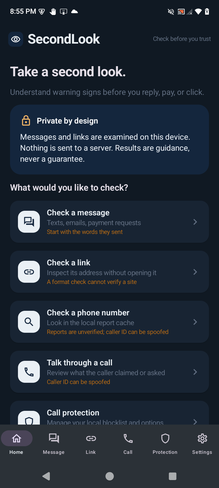
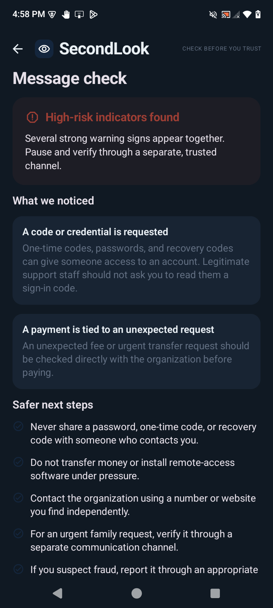
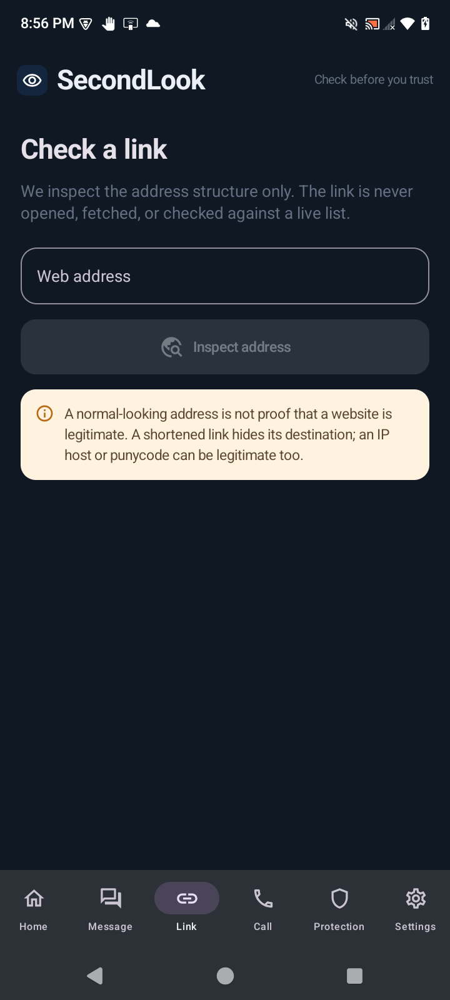
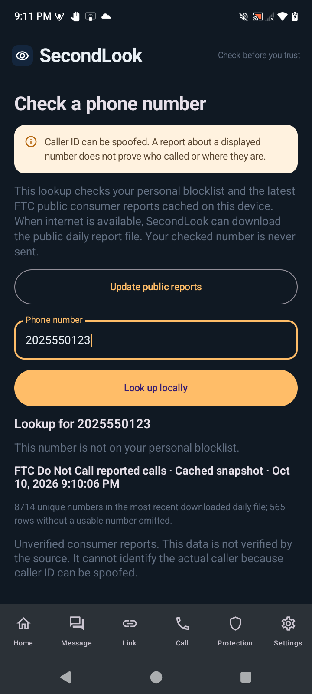
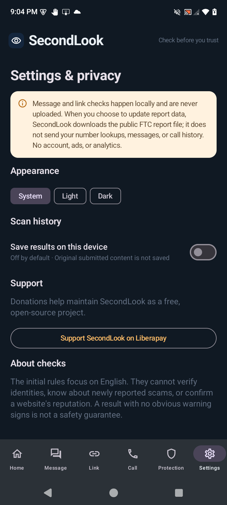

# SecondLook

**Check Before You Trust.** SecondLook is an open-source Android app for checking suspicious messages, links, and call stories with explainable rules that run on the device.

## Screenshots

These genuine screenshots show SecondLook running on a BLU B1660V with Android 15. The message result uses a synthetic example, and the phone lookup uses the fictional 202-555-0123 test number.

| Home | Message result |
|---|---|
|  |  |

| Link inspection | Phone lookup | Settings and support |
|---|---|---|
|  |  |  |

## What it does

- Analyzes pasted messages and call descriptions for pressure, threats, credential requests, unusual payments, impersonation, and other explicit warning patterns.
- Inspects URL structure without opening or fetching the address.
- Looks up phone numbers against the personal blocklist and a local cache of FTC Do Not Call reported-call complaints. The app can manually or periodically download the latest published daily CSV when connected; Android may defer background refresh.
- Lets the user choose a compatible calling or messaging app for a number without placing a call, sending a message, or changing defaults.
- Offers optional Android call screening using the system call-screening role, an exact-match local blocklist, and opt-in private-caller silencing.
- Keeps optional scan history off by default. A user can save an individual result or enable history for future checks; saved records contain a short result report, not the submitted message.
- Supports system, light, and dark appearance.

The initial rule set is English-focused. Results are guidance, not a guarantee. It cannot verify a sender or caller, check a website's live reputation, know about every recent scam, or protect the whole device. A link with no structural flags is not verified as safe. Unknown calls are allowed. FTC entries are unverified consumer reports, not confirmed scam findings, and never automatically block a call. Caller ID can be spoofed; no physical caller location is inferred. A missing report is not proof of safety.

## Privacy

Manual text and URL analysis runs locally and is not uploaded. The app has no account, advertising, analytics, or third-party analysis service. Its Internet permission is used only to download the public FTC daily complaints CSV; looked-up phone numbers, messages, URLs, contacts, and call histories are not uploaded. FTC caller numbers are aggregated in a local cache with report counts and dates; consumer location and complaint subject are discarded. The blocklist and optional result history are stored in the app's local database. Scan history is disabled by default, individual results can be saved by choice, and saved history can be cleared in Settings. Android call-screening must be selected by the user; it responds using local rules and allows a call if local screening fails. Android may record a call that the system blocks according to its own call-screening behavior.

The app does not request microphone, SMS, contacts, call-log, notification-reading, or accessibility permissions. Local app storage does not protect data from every form of device compromise.

## Build

Requirements: JDK 17 or newer and Android SDK platform 35. The project uses Gradle 8.10.2, Android Gradle Plugin 8.8.2, and Kotlin 2.1.20.

```sh
./gradlew testDebugUnitTest
./gradlew assembleDebug
SECONDLOOK_SIGNING_PROPERTIES=/secure/path/secondlook-signing.properties ./gradlew assembleRelease
```

## Download and install

When a public release is available, download the signed APK from the project’s GitHub Releases page and verify the published SHA-256 checksum before installing. Android 8.0 or newer is required. Open the downloaded APK on the device and follow Android’s package-installer prompts. The `1.0.0-rc.1` candidate is currently built locally and has not yet been published online.

Install the debug APK on a connected, designated test device with:

```sh
adb install app/build/outputs/apk/debug/app-debug.apk
```

To run Compose instrumentation tests on an available Android device or emulator:

```sh
./gradlew connectedDebugAndroidTest
```

## Tests

`app/src/test` covers scam and benign message examples, URL parsing and structure, the FTC CSV schema/parser, transparent result categories, and pure call-screening decisions. `app/src/androidTest` covers the Compose dashboard, data migration/persistence, local cache validation, and share/lookup flows. See the build report for actual results. The release variant is signed only when `SECONDLOOK_SIGNING_PROPERTIES` points to an external properties file. Keep its keystore and properties outside the repository with restrictive permissions, and back up both securely. Without that configuration CI builds an unsigned release APK.

## Source data

SecondLook retrieves the FTC Do Not Call reported-calls daily CSV from links published by the Federal Trade Commission. Most FTC website material is a U.S. government work and public domain, with attribution requested where feasible; third-party material may be excluded. SecondLook credits the FTC and redistributes only derived number counts/timestamps, not complaint text or consumer location. The FTC states that reported-call entries are not verified. See [FTC source-data and privacy disclosures](PRIVACY.md).

## Support

If SecondLook is useful to you, [support its continued maintenance on Liberapay](https://liberapay.com/DeveloperCal/). Donations help keep this free, open-source project maintained.

## Contributing

Bug reports and focused pull requests are welcome. Read [CONTRIBUTING.md](CONTRIBUTING.md) before proposing changes. Please do not submit private messages, personal phone numbers, or private caller information in issues.

## License

GPL-3.0-only. See [LICENSE](LICENSE).
